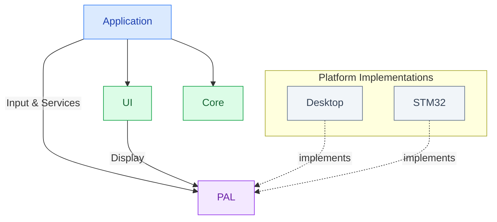

# Software Architecture

UNWIRED uses a platform-independent application architecture. The desktop simulator 
and STM32 firmware share the same application logic and user interface, while
platform-specific functionality is provided through the Platform Abstraction Layer (PAL).

Repository layout and directory paths are documented in [Repository Structure](repo_structure.md).

## Layer Model

The diagram represents module dependencies, not runtime data flow.

**App is the central coordinator** between UI, Core and PAL. UI and Core do not communicate
directly. App coordinates application-level operations and provides UI with the data
required for presentation.

App polls input through PAL and passes normalized events to UI. UI uses PAL Display for rendering.
Core remains independent of App, UI and PAL.

Platform implementations fulfill PAL contracts and are selected during application initialization.

## Layer Responsibilities

### Application

Coordinates the shared application lifecycle and runtime behavior.

App polls normalized input events through PAL Input and passes them to UI for interpretation.
It requests UI updates and rendering, processes actions generated by UI, invokes Core operations
and coordinates platform-dependent operations through PAL. It is responsible for maintaining
consistency between the logical device state and external devices, such as the switching matrix.

App provides UI with the application data and operation results required for presentation. App
does not implement domain rules, screen-specific behavior or platform-specific drivers.

The platform-specific entry point controls the execution loop and invokes App operations.

### Core

Owns the device's domain state and logic, including modules, ports, connections, routing rules
and presets. Core validates operations, manages the logical device state and determines the
required routing operations.

It exposes platform-independent operations and data to App without communicating directly with
UI or PAL. Core does not depend on App, UI, PAL or platform-specific code.

### UI

Owns screen navigation, selection, editing state, input interpretation and presentation.

App requests UI updates and rendering. UI receives normalized input events from App and
interprets them according to the current screen and UI state. Interactions
requiring application-level operations are represented as UI actions and returned to App for
processing. During rendering, UI uses PAL Display interfaces to draw the device interface.

UI receives application data and operation results through App. It does not invoke Core
operations or modify Core state directly. UI-specific state, such as the selected menu item,
remains separate from domain state, such as active connections. UI does not depend on App or
concrete platform implementations. UI does not poll PAL Input.

### Platform Abstraction Layer

Defines platform-independent C interfaces for the external capabilities required by the
application, such as display output, input events, matrix switching and persistent storage.

PAL specifies *what* the application can request, not *how* a platform performs the operation.
It also defines platform-independent operation results and error types.

PAL does not contain platform-specific implementations and does not depend on App, UI or Core.

### Platform Implementations

Provide concrete implementations of PAL interfaces and platform-specific execution environments.

- Desktop runs the desktop simulator using desktop libraries, a virtual control panel and
  simulated hardware.
- STM32 runs the firmware using microcontroller peripherals and hardware drivers.

Platform-specific entry points initialize the execution environment, construct PAL
implementations and start the shared App. Each platform controls its own execution loop,
invoking App updates and rendering as required.

The desktop simulator may provide additional visualization and interaction features, but the
device UI and application behavior remain shared between platforms. Platform implementations may
use SDL or STM32 HAL internally, but these dependencies must not leak into App, Core, UI or PAL
interfaces.

## Data Flow

The application follows an event-driven processing model coordinated by App.

### Input and Application Operations

1. The platform-specific entry point invokes `app_update()`.
2. App polls normalized input events through PAL Input.
3. App passes the retrieved events to UI for handling during the update.
4. UI interprets events according to its current screen and internal state.
5. UI either updates its presentation state or produces a UI action.
6. App processes UI actions by invoking Core operations.
7. When necessary, App executes platform-dependent operations through PAL.
8. App handles operation results, updates the logical state through Core and provides feedback to
   UI.

Not every input event generates a UI action. Navigation and selection changes may be handled
entirely within UI. Core is responsible for domain validation and logical state management,
while App coordinates operations involving external devices.

### Rendering

1. The platform-specific entry point invokes `app_render()`.
2. App provides UI with the application data required for presentation.
3. App requests UI rendering.
4. UI renders the current screen through PAL Display.
5. The platform-specific implementation updates the physical or simulated display.

On desktop, the device display may be rendered into a texture that is subsequently composited
with the virtual control panel. App controls when UI rendering is requested, while UI determines
what is drawn.

## Dependency Rules

1. **App, Core and UI are shared** by desktop and firmware builds.
2. **App depends on UI, Core and PAL**, but never on concrete platform implementations.
3. **UI depends on PAL contracts** for normalized input event types and display operations, but
   not on App, Core or platform-specific implementations. App polls input and delivers events
   to UI; UI does not access PAL Input to retrieve events.
4. **UI and Core do not communicate directly.** App coordinates application-level operations and
   data exchange between them.
5. **Core is independent** of App, UI, PAL and platform-specific code.
6. **PAL defines platform-independent contracts** and does not depend on App, UI, Core or platform
   implementations.
7. **Platform implementations fulfill PAL contracts.** Platform-specific entry points assemble and
   launch the shared application through dependency injection.
8. **Tests may substitute PAL implementations** to verify application behavior without desktop
   libraries or physical hardware.

Dependencies must not form cycles. The key architectural constraint is that adding or replacing
a platform must not require rewriting the shared App, UI or Core modules. Platform-specific
functionality must remain behind PAL interfaces or within platform-specific code.
